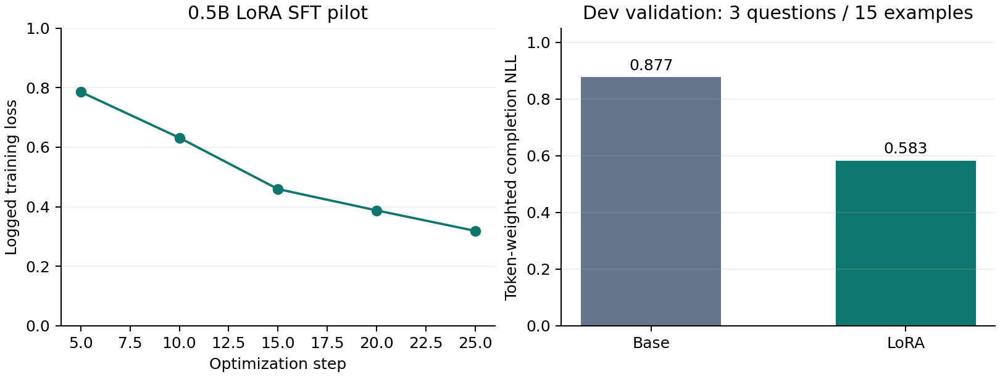

# Agent 可靠性评测与 LoRA 后训练实验闭环

从零实现 ReAct 工具调用 Agent，将**可靠执行 → 无答案泄漏的评测 → 开发集轨迹构建 → 实际 LoRA SFT → 验证与归档**串成可审计流程。核心 Agent 不依赖 LangChain、AutoGen 等框架。

原始作者：Xuanyi Song。原型保留在 `codex/archive-original-d95783a`；本次改进分支为 `codex/reproducible-agent-eval`。

> 历史 README 的 8%→43%、8.33%→25% 存在重复运行/挑选偏差，已撤回作为性能证据。旧代码和日志保留；下表来自重新冻结的单轨迹成对实验，不与旧数值直接相减。

## 本次实测

Qwen2.5-7B-Instruct API；test 215 题，seed=11，OFF/ON 各一条轨迹，共 **430 条**。两组均可在错误后继续，调用上限 8、每次输出上限 600 tokens。所有失败保留，10 次 API 超时也计入分母。

| 任务 | 错误反馈 OFF | 错误反馈 ON | ON−OFF 的题目聚类 bootstrap 95% CI |
|---|---:|---:|---:|
| QA 严格答案 EM（166 题） | 71/166，42.77% | 69/166，41.57% | −1.20 pp，[-6.63, 3.61] pp |
| 数学严格准确率（49 题） | 6/49，12.24% | 8/49，16.33% | +4.08 pp，[-6.12, 14.29] pp |

**本次没有稳定的准确率增益证据。** 数学协议完成率由 51.02% 升至 91.84%，平均 LLM 调用由 6.27 降至 4.37；完成仅表示产出了合法最终答案，不表示答对。实际 token 消耗单独记录，不把调用下降等价为费用下降。

QA 使用公开候选段落上的固定 BM25 检索：199 题各 10 段、1 题 2 段，工具不包含标准答案或 supporting-fact 标签。这是受控检索条件，不能当作实时联网能力或 HotpotQA 官方完整榜单成绩。实时检索限流与并行 API 压力运行单独归档，不择优替换结果。

另在预先按哈希确定的 20 题上增加 seed=29/47，共 80 条新轨迹；seed=11 直接复用主实验 40 条轨迹。该小子集的三种子结果独立报告，不能声称完整 215 题均做了三种子测试。

数学 scorer 修正了大整数精度与微小数下溢问题；对同一批预测离线重判，新增模型调用为 0，主实验判定变化为 0。原指标与修正记录都保留。

完整证据：[主实验报告](reports/final-seed11-v3-20261025/report.md)、[稳定性分析](reports/final-stability-20261025/report.md)、[精度修正说明](docs/scoring-amendment.md)、[预声明计划](docs/final-rerun-plan.md)。

## 核心实现

- **手写 ReAct 状态机**：协议解析、任务工具白名单、结构化 ToolResult、完整轮次记忆窗口、错误反馈、终止条件。
- **推理与判分隔离**：Agent 不接收 ground truth。每次推理尝试（包括格式失败）计入预算；没有答案命中提前终止，也不因答错而重新生成。
- **可审计评测**：问题哈希与 dev/test 划分、版本化 scorer、冻结 manifest、逐题 fsync、断点恢复、配对统计与错误归因。已开始但未完成的任务记为中断失败，不重采样。
- **检索与执行**：固定语料 BM25 / 实时 MediaWiki 两种后端；Python 独立临时目录、环境清理、import/AST 限制、超时。它是受限子进程，**不是安全沙箱**。
- **后训练数据工程**：dev-only 单步 SFT、同一完整 prompt 下的偏好候选、去重、题目组 train/validation 隔离、来源追溯与审核标志。
- **真实 LoRA 验证**：GPU 上完成 0.5B 模型训练、实际 loss mask 审计、基座/适配器 NLL 对比，并支持本地模型接入 Agent。

当前 ON/OFF 对照是 **observable-error feedback / self-repair**，不是语义正确性验证器或 Reflexion 论文完整复现。

## 快速开始

Python 3.10+，在仓库根目录执行：

```powershell
python -m venv .venv
.venv\Scripts\Activate.ps1
python -m pip install -r requirements-dev.txt
Copy-Item .env.example .env
# 填写自己的 LLM_API_KEY / LLM_BASE_URL
python -m eval.prepare_data
python -m pytest -q
```

单次 Agent 运行：

```powershell
python -m agent.run --task MATH --query "Use Python to calculate 123 * 456." --output outputs/my-agent.json
```

先检查开发集，再声明新的完整实验（会调用收费 API）：

```powershell
python -m eval.run_eval --split dev --limit 2 --seeds 11 --workers 2 --output outputs/my-smoke
python -m eval.run_eval --retrieval snapshot --split test --seeds 11 --workers 4 --api-interval 1 --metric-version strict-v3 --output outputs/my-test
python -m eval.verify_run outputs/my-test
python -m eval.analyze_failures outputs/my-test
python -m eval.archive outputs/my-test --output reports/my-test
```

同一输出目录禁止并行写入。恢复时保持原代码/数据/配置，重复相同命令并加 `--resume`。远端 API seed 不能保证供应商的确定性。模型 API 单进程最多 2 个在途请求；不要并行启动多个 rollout 进程绕过这一限制。

新 grader 的离线重判不会调用模型：

```powershell
python -m eval.rescore <原实验目录> --output <新的空目录> --version strict-v3
```

详见 [评测协议](docs/evaluation-protocol.md)、[固定语料说明](docs/frozen-retrieval.md)、[系统边界](docs/architecture.md)。

## 实际后训练验证

从 QA 开发集轨迹导出 78 条 SFT：63 条/15 题训练，15 条/3 题验证。Qwen2.5-0.5B-Instruct，固定 HF 提交，bf16 LoRA r=16 / alpha=32，25 steps，约 89 秒。

独立、token 加权的开发验证 completion NLL：**0.877 → 0.583**。这只是 3 道题上的小规模训练链路验证，不是答题准确率增益，也没有 7B SFT / DPO / RLHF / GRPO 效果结论。

实际 TRL collator 检查了全部 78 条：45,073 个上下文 token 全部 mask，2,629 个 completion token 参与监督；最长序列 1,473，未截断。另有数学 SFT 导出和 3 组待审核偏好候选；未把它们当作已经完成的偏好训练。



[训练记录](docs/lora-pilot.md) · [数据构造与复现](docs/post-training.md) · [权重哈希与位置](reports/lora-qwen05b-20261025/weights.json)。本地数学 Agent 演示曾在 4 次调用预算内失败，原始记录保留，没有重跑到正确。

## 目录与求职材料

```text
agent/          API / 本地模型后端、协议解析、ReAct、单次运行 CLI
tools/          结构化结果、受限 Python、Wikipedia / 固定 BM25
eval/           数据审计、冻结计划、判分、验证、重判、统计与归档
post_training/  SFT / 偏好候选、LoRA、loss mask 审计、验证
tests/          不需要 API Key 的离线回归测试
data/           原数据、validated 副本与不含答案标签的候选语料
logs/           历史有偏日志，仅用于审计
reports/        本次实验原始轨迹压缩归档与证据
docs/           协议、升级记录、项目复盘与简历材料
```

[简历与面试表述](docs/resume-and-interview.md)。问题来自历史项目，曾用于调试；本次 test 是操作性冻结划分，不声称完全未见或已验证预训练去污染。数据归属见 [DATA_ATTRIBUTION.md](DATA_ATTRIBUTION.md)。
