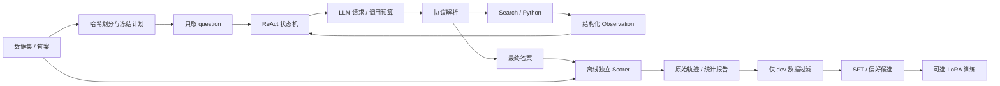

# Agent 与评测边界

不允许从 scorer/标准答案指向 Agent 的反馈边；反思开关只控制对已观测协议和工具错误的提示。模型最终答案错误时不会被告知错误，也不会重新生成。

- 每次推理对应一个 event，包含真实 messages 和 provider response。
- 每个工具响应为 ToolResult，明确区分 content / is_error / error_type / cached，不能靠 Error 单词猜测成败。
- trajectory 保留所有原始回复；上下文窗口只保留完整交互轮，格式错误文本不重新喂给模型。
- 任务开始事件先落盘，再执行模型调用；完成后将完整结果追加并 fsync。恢复时不重采样已开始任务。
- API key 仅存在运行时客户端与本地 .env，不进入模型 messages、子进程环境或 Git 归档。
- 偏好样本只在同一个完整 prompt 下比较不同输出；这比按同一个问题拼接任意两条轨迹更严格。
